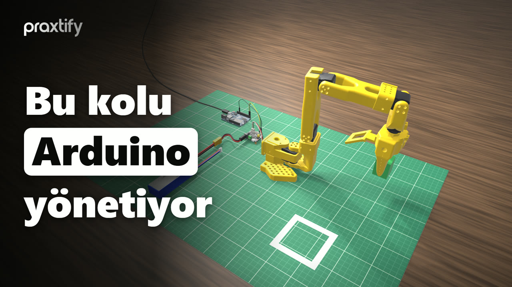
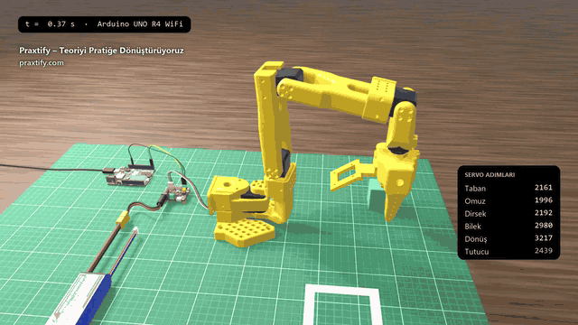
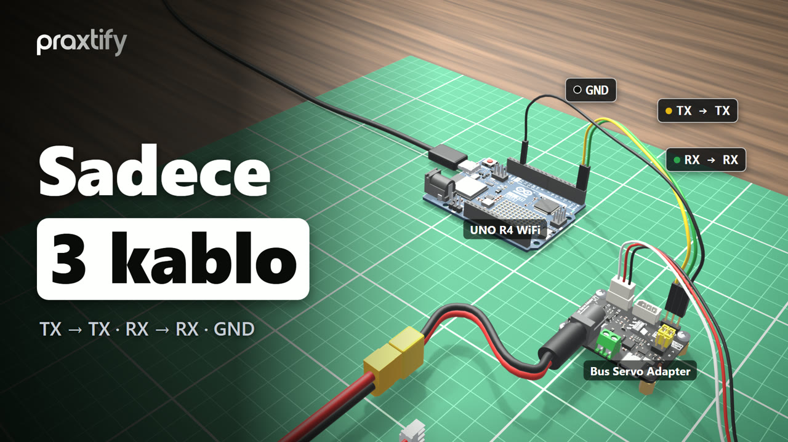
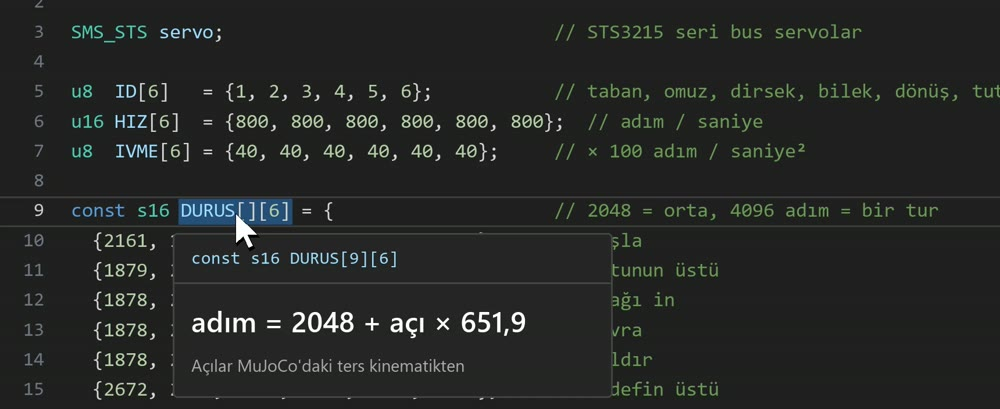
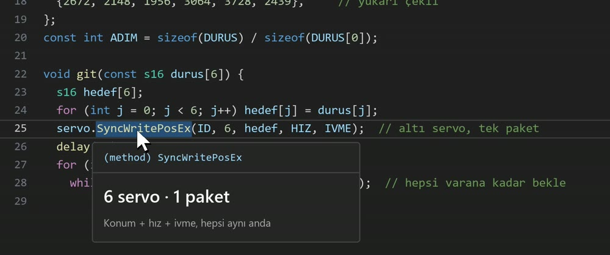

<a id="top"></a>

<div align="center">



### 🇬🇧 [English](#en) &nbsp;·&nbsp; 🇹🇷 [Türkçe](#tr) &nbsp;·&nbsp; 🇩🇪 [Deutsch](#de)

</div>

---

<a id="en"></a>

<div align="center">

🇬🇧 **English** &nbsp;·&nbsp; 🇹🇷 [Türkçe](#tr) &nbsp;·&nbsp; 🇩🇪 [Deutsch](#de)

# Robot Arm with Arduino: Pick-and-Place · UNO R4 WiFi + SO101

[](https://www.youtube.com/@praxtify)
[](https://praxtify.com)

**How does an Arduino drive this arm?** This repo contains the Arduino code with which the SO101 robot arm, built from six
STS3215 serial bus servos, picks up a box and places it on a target. The poses are computed with inverse kinematics in MuJoCo,
converted to servo steps and sent to all six servos over **a single cable**. No real arm? You can run the same code in the **MuJoCo simulation**.

[](https://docs.arduino.cc/hardware/uno-r4-wifi/)
[](https://www.python.org/)
[](https://mujoco.org/)
[](LICENSE)
[](https://www.youtube.com/@praxtify)

</div>

<p align="center">
  
</p>

---

## Contents

- [What you'll learn](#what-youll-learn)
- [Hardware](#hardware)
- [Wiring](#wiring)
- [Upload the code](#upload-the-code)
- [No arm? MuJoCo simulation](#no-arm-mujoco-simulation)
- [Project structure](#project-structure)
- [How it works](#how-it-works)
- [Try it yourself](#try-it-yourself)
- [Credits and licenses](#credits-and-licenses)
- [Praxtify](#praxtify)

## What you'll learn

| Topic | In this project |
|---|---|
| Serial bus servos | Six STS3215 daisy-chained on one cable, each with its own ID |
| From angle to step | Converting the joint angles from inverse kinematics into servo steps: `step = 2048 + angle × 651.9` |
| Synchronised motion | Position, speed and acceleration for six servos **in one packet** with `SyncWritePosEx` |
| Feedback | Asking each servo "are you still moving?" with `ReadMove` and waiting |
| Hardware UART | `Serial1` (D0/D1) on the UNO R4, a 1 Mbit/s line independent of USB |

The whole Arduino code is **a single file, 41 lines**: [`al_birak/al_birak.ino`](al_birak/al_birak.ino). It is identical to the code explained in the video.

## Hardware

| Part | Role |
|---|---|
| **SO101 robot arm** (6 × Feetech STS3215) | Base, shoulder, elbow, wrist, wrist roll, gripper |
| **Arduino UNO R4 WiFi** | Runs the code and sends commands to the servo board over UART |
| **Waveshare Bus Servo Adapter (A)** | Converts the Arduino's UART signal to the servos' single-wire bus and powers the servos |
| **3S Li-Po battery** (11.1 V) + XT60 → DC adapter | Servo power |
| 3 × dupont jumper wires | TX, RX, GND |
| USB-C cable | Power and code for the Arduino |

> [!WARNING]
> The STS3215 comes in **7.4 V** and **12 V** versions. Choose the battery voltage to match the servos in your arm; the setup in the video uses an 11.1 V 3S battery.

## Wiring

<p align="center"></p>

1. **Set the two jumpers on the servo board to position A.** The board now takes its commands from the UART pins.
2. **Three jumper wires** — on this board the connection is **straight, not crossed**:

   | Arduino UNO R4 WiFi | Waveshare Bus Servo Adapter (A) |
   |---|---|
   | D1 (TX) | TX |
   | D0 (RX) | RX |
   | GND | GND |

3. Plug the **servo chain cable** into the board, then connect the **battery**. The board's red LED lights up.
4. Connect the Arduino to your computer with **USB-C**.

## Upload the code

With the Arduino IDE: install `SCServo` from the **Library Manager** and *Arduino UNO R4 Boards* from the **Boards Manager**,
open `al_birak/al_birak.ino`, select *Arduino UNO R4 WiFi* as the board and upload.

From the command line ([arduino-cli](https://arduino.github.io/arduino-cli/)):

```bash
git clone https://github.com/praxtify/1-arduino-robot-kol.git
cd 1-arduino-robot-kol

arduino-cli core install arduino:renesas_uno
arduino-cli lib install SCServo

arduino-cli compile -b arduino:renesas_uno:unor4wifi al_birak
arduino-cli upload  -b arduino:renesas_uno:unor4wifi -p <PORT> al_birak   # Windows: COM3 · Linux: /dev/ttyACM0
```

Build output: **20%** of program storage (54,372 / 262,144 bytes). The arm performs the task once, 1 second after the board powers up.

> [!IMPORTANT]
> - The numbers in the table assume **2048 steps = zero angle in MuJoCo**. On a real arm the servos' centre positions must be
>   calibrated to this pose; otherwise the arm will move to different points.
> - On the first run, lower the `HIZ` (speed) values (for example to 300) and keep the area around the arm clear.
> - Code comments and identifiers are in Turkish (`HIZ` = speed, `IVME` = acceleration, `DURUS` = pose, `git` = go).
> - Tested with: arduino-cli 1.5 · Arduino UNO R4 Boards 1.6.0 · SCServo 1.0.2.

## No arm? MuJoCo simulation

`simulasyon/arduino_sim.py` **reads `al_birak.ino` directly** (HIZ, IVME, the DURUS table and the delays) and plays the code
back in MuJoCo. The servos move with the speed and acceleration from the code; grasping and releasing the box are handled
entirely by the physics engine's contact computation.

```bash
python -m venv .venv
# Windows:      .venv\Scripts\activate
# macOS/Linux:  source .venv/bin/activate
pip install -r requirements.txt

python simulasyon/arduino_sim.py               # with a 3D window
python simulasyon/arduino_sim.py --ekransiz    # headless: print the result only
```

Expected output (in Turkish: "9 poses, 8.9 s · box released 1.8 mm from the centre of the target"):

```text
9 duruş, 8.9 sn · kutu hedefin ortasına 1.8 mm yakın bırakıldı
```

If you change the table in the `.ino`, the simulation changes too: you can try it here before uploading the code to the board.

> [!NOTE]
> - Run the commands **from the repo folder**.
> - **On macOS**, use `mjpython` instead of `python` to run with a window (it ships with MuJoCo).
> - Tested with: Python 3.13 · MuJoCo 3.15 · NumPy 2.5 (Windows 11).

## Project structure

```text
1-arduino-robot-kol/
├── al_birak/
│   └── al_birak.ino                        # Arduino code (as in the video)
├── simulasyon/
│   ├── sahne.py                            # SO101 + box scene, inverse kinematics, pick-and-place plan
│   ├── duruslar.py                         # regenerates the DURUS table with inverse kinematics
│   └── arduino_sim.py                      # reads the .ino and plays it back in MuJoCo
├── models/
│   └── mujoco_menagerie/robotstudio_so101/ # SO101 robot model (MuJoCo Menagerie, Apache 2.0)
├── docs/                                   # README images
├── requirements.txt                        # mujoco, numpy (simulation only)
└── LICENSE                                 # MIT (project code)
```

## How it works

### 1 · Servos: six motors, one cable

```cpp
#include <SCServo.h>                        // Feetech servo kütüphanesi
SMS_STS servo;                              // STS3215 seri bus servolar

u8  ID[6]   = {1, 2, 3, 4, 5, 6};           // taban, omuz, dirsek, bilek, dönüş, tutucu
u16 HIZ[6]  = {800, 800, 800, 800, 800, 800};  // adım / saniye
u8  IVME[6] = {40, 40, 40, 40, 40, 40};     // × 100 adım / saniye²
```

One revolution of the STS3215 is **4096 steps**. 800 steps per second is about **70°/s** (800 × 360 / 4096). The acceleration is 40 × 100 = 4000 steps/s².

### 2 · Pose table: from angle to step

Each row is one pose of the arm, and its six numbers are the targets of the six servos: start, above the box, descend, grasp, lift, above the target,
lower, release, retract.

<p align="center"></p>

The numbers were not typed by hand. For each pose, MuJoCo is given the point the gripper tip should reach, **inverse kinematics** finds
the joint angles and each angle is converted to a servo step:

$$\text{step} = 2048 + \theta \cdot \frac{4096}{2\pi} \approx 2048 + \theta \cdot 651.9$$

To generate the table yourself:

```bash
python simulasyon/duruslar.py
```

The output is **identical** to the `DURUS` table in `al_birak.ino` (in every pose the tip is within 0.3 mm of the target).
In the **grasp** row only the last number changes: the gripper closes from 2439 to 1937 and squeezes the box.

### 3 · `git()`: one packet, then wait

<p align="center"></p>

```cpp
servo.SyncWritePosEx(ID, 6, hedef, HIZ, IVME);  // altı servo, tek paket
delay(20);
for (int j = 0; j < 6; j++)
  while (servo.ReadMove(ID[j]) == 1) delay(10);  // hepsi varana kadar bekle
```

`SyncWritePosEx` sends position, speed and acceleration to all six servos **in one packet**; they all start moving at the same time.
`ReadMove` asks each servo whether it is still moving. Once even the slowest servo has arrived, the next pose begins.

### 4 · Setup and task

```cpp
Serial1.begin(1000000);                   // D0 / D1 → Waveshare UART
servo.pSerial = &Serial1;
```

`Serial1` is the UNO R4's **D0 and D1** pins: a hardware UART that runs independently of USB and goes straight to the servo board. The line
is opened at 1 megabit per second. The table is then stepped through in order, with a 300 ms pause after each pose (so the gripper can settle).

### 5 · Simulation: the code running in MuJoCo

`arduino_sim.py` mimics the servos' **trapezoidal velocity profile**: they accelerate with the acceleration from the code, travel at most at `HIZ`
and decelerate at the same rate to stop. Over short distances they turn back before reaching top speed (triangular profile). The duration of one move:

$$T = \frac{d}{v} + \frac{v}{a} \quad (d \ge v^2/a), \qquad T = 2\sqrt{d/a} \quad (d < v^2/a)$$

At every 5 ms physics step the servo targets are passed to the motors and `mj_step` advances the world. The task finishes in 8.9 seconds and the box
is placed **1.8 mm** from the centre of the target.

## Try it yourself

- Lower `HIZ` to 400: how much longer does the task take? (`arduino_sim.py --ekransiz` prints the duration.)
- Change 1937 in the **grasp** row to 2100: if the gripper doesn't squeeze the box hard enough, does the box slip?
- Change `DROP_SPOT` in `simulasyon/sahne.py`, generate the new table with `duruslar.py` and paste it into the `.ino`.
- Remove `delay(300)`: what happens if the gripper lifts before it has fully closed?

## Credits and licenses

The **project code** in this repo ([`al_birak.ino`](al_birak/al_birak.ino) and [`simulasyon/`](simulasyon)) is released under the [MIT license](LICENSE).
Third-party parts come with their own licenses:

| Component | Source | License | In repo |
|---|---|---|---|
| **SO101 robot model** (MJCF + STL) | [MuJoCo Menagerie · `robotstudio_so101`](https://github.com/google-deepmind/mujoco_menagerie/tree/main/robotstudio_so101) — based on The Robot Studio's [SO-ARM100 / SO101](https://github.com/TheRobotStudio/SO-ARM100) design | [Apache 2.0](models/mujoco_menagerie/robotstudio_so101/LICENSE) | ✔ `models/` (unmodified) |
| **SCServo** Arduino library | [workloads/scservo](https://github.com/workloads/scservo) (from Feetech & Waveshare) | GPL-3.0 | installed via Library Manager |
| **Arduino UNO R4 Boards** core | [arduino/ArduinoCore-renesas](https://github.com/arduino/ArduinoCore-renesas) | MIT | installed via Boards Manager |
| **MuJoCo** physics engine | [Google DeepMind](https://github.com/google-deepmind/mujoco) | Apache 2.0 | installed via `pip` |
| **NumPy** | [numpy.org](https://numpy.org/) | BSD 3-Clause | installed via `pip` |

The 3D models in the images are for illustration only and are not part of the repo. The cables were modelled in Blender by Praxtify.
The other part models (Arduino UNO R4 WiFi, Waveshare servo adapter, Li-Po battery) come from the [GrabCAD](https://grabcad.com/library) community.

## Praxtify

**Turning theory into practice.** We teach robotics, embedded systems and AI step by step, with working code.
For this project's video and new projects:

<p align="center">
  <a href="https://praxtify.com"></a>
  <a href="https://www.youtube.com/@praxtify"></a>
  <a href="https://www.instagram.com/praxtify"></a>
  <a href="https://www.tiktok.com/@praxtify"></a>
  <a href="https://x.com/praxtify"></a>
  <a href="https://www.threads.net/@praxtify"></a>
  <a href="https://www.linkedin.com/company/praxtify"></a>
  <a href="https://www.facebook.com/praxtify"></a>
  <a href="https://www.pinterest.com/praxtify"></a>
</p>

For questions, bugs or suggestions, open an [issue](../../issues). If you like the project, don't forget to give it a ⭐!

**Previous project in the series:** [0-mujoco-ters-kinematik](https://github.com/praxtify/0-mujoco-ters-kinematik): solving the inverse kinematics of the same arm from scratch.

**Next project in the series:** [2-arduino-radar](https://github.com/praxtify/2-arduino-radar): building a desk radar with an HC-SR04 and an SG90.

<p align="right"><a href="#top">↑ Back to top</a></p>

---

<a id="tr"></a>

<div align="center">

🇬🇧 [English](#en) &nbsp;·&nbsp; 🇹🇷 **Türkçe** &nbsp;·&nbsp; 🇩🇪 [Deutsch](#de)

# Arduino ile Robot Kol: Al-Bırak · UNO R4 WiFi + SO101

[](https://www.youtube.com/@praxtify)
[](https://praxtify.com)

**Bu kolu bir Arduino nasıl yönetiyor?** Bu repo, altı STS3215 seri bus servolu SO101 robot kolunun bir kutuyu alıp
hedefe bıraktığı Arduino kodunu içerir. Duruşlar MuJoCo'da ters kinematikle hesaplanır, servo adımına çevrilir ve
**tek kablo** üzerinden altı servoya birden gönderilir. Gerçek kolun yoksa aynı kodu **MuJoCo simülasyonunda** çalıştırabilirsin.

[](https://docs.arduino.cc/hardware/uno-r4-wifi/)
[](https://www.python.org/)
[](https://mujoco.org/)
[](LICENSE)
[](https://www.youtube.com/@praxtify)

</div>

<p align="center">
  
</p>

---

## İçindekiler

- [Ne öğreneceksin?](#ne-öğreneceksin)
- [Donanım](#donanım)
- [Bağlantılar](#bağlantılar)
- [Kodu karta yükle](#kodu-karta-yükle)
- [Kolun yoksa: MuJoCo simülasyonu](#kolun-yoksa-mujoco-simülasyonu)
- [Proje yapısı](#proje-yapısı)
- [Nasıl çalışıyor?](#nasıl-çalışıyor)
- [Kendin dene](#kendin-dene)
- [Kaynaklar ve lisanslar](#kaynaklar-ve-lisanslar)
- [Praxtify](#praxtify-1)

## Ne öğreneceksin?

| Konu | Bu projede |
|---|---|
| Seri bus servo | Altı STS3215 tek kabloya zincirli; her birinin kendi kimliği (ID) var |
| Açıdan adıma | Ters kinematiğin verdiği eklem açılarını servo adımına çevirme: `adım = 2048 + açı × 651,9` |
| Eş zamanlı hareket | `SyncWritePosEx` ile altı servoya **tek pakette** konum, hız ve ivme |
| Geri bildirim | `ReadMove` ile her servoya "hâlâ hareket ediyor musun?" diye sorup bekleme |
| Donanım UART | UNO R4'te `Serial1` (D0/D1), USB'den bağımsız 1 Mbit/sn hat |

Arduino kodunun tamamı **tek dosya, 41 satır**: [`al_birak/al_birak.ino`](al_birak/al_birak.ino). Videoda anlatılan kodla birebir aynıdır.

## Donanım

| Parça | Görevi |
|---|---|
| **SO101 robot kol** (6 × Feetech STS3215) | Taban, omuz, dirsek, bilek, bilek dönüşü, tutucu |
| **Arduino UNO R4 WiFi** | Kodu çalıştırır, servo kartına UART üzerinden komut gönderir |
| **Waveshare Bus Servo Adapter (A)** | Arduino'nun UART sinyalini servoların tek telli bus hattına çevirir, servolara güç verir |
| **3S Li-Po pil** (11,1 V) + XT60 → DC dönüştürücü | Servo gücü |
| 3 × dupont jumper kablo | TX, RX, GND |
| USB-C kablo | Arduino'ya güç ve kod |

> [!WARNING]
> STS3215'in **7,4 V** ve **12 V** sürümleri var. Pil voltajını kolundaki servoların sürümüne göre seç; videodaki kurulum 11,1 V'luk 3S pil kullanır.

## Bağlantılar

<p align="center"></p>

1. **Servo kartında iki jumper'ı A konumuna al.** Kart artık kontrolü UART pinlerinden alır.
2. **Üç jumper kablo** — bu kartta bağlantı **çapraz değil, düz**:

   | Arduino UNO R4 WiFi | Waveshare Bus Servo Adapter (A) |
   |---|---|
   | D1 (TX) | TX |
   | D0 (RX) | RX |
   | GND | GND |

3. **Servo zincir kablosunu** karta tak, sonra **pili** bağla. Kartın kırmızı ışığı yanar.
4. **USB-C** ile Arduino'yu bilgisayara bağla.

## Kodu karta yükle

Arduino IDE kullanıyorsan: **Library Manager**'dan `SCServo`'yu, **Boards Manager**'dan *Arduino UNO R4 Boards*'u kur,
`al_birak/al_birak.ino`'yu aç, kart olarak *Arduino UNO R4 WiFi*'yi seçip yükle.

Komut satırından ([arduino-cli](https://arduino.github.io/arduino-cli/)):

```bash
git clone https://github.com/praxtify/1-arduino-robot-kol.git
cd 1-arduino-robot-kol

arduino-cli core install arduino:renesas_uno
arduino-cli lib install SCServo

arduino-cli compile -b arduino:renesas_uno:unor4wifi al_birak
arduino-cli upload  -b arduino:renesas_uno:unor4wifi -p <PORT> al_birak   # Windows: COM3 · Linux: /dev/ttyACM0
```

Derleme çıktısı: program alanının **%20**'si (54 372 / 262 144 bayt). Kol, kart açıldıktan 1 saniye sonra görevi bir kez yapar.

> [!IMPORTANT]
> - Tablodaki sayılar **2048 adım = MuJoCo'daki sıfır açı** varsayımıyla hesaplandı. Gerçek kolda servoların orta konumu bu
>   duruşa göre kalibre edilmiş olmalı; değilse kol farklı noktalara gider.
> - İlk denemede `HIZ` değerlerini düşür (örneğin 300) ve kolun çevresini boş tut.
> - Test edilen ortam: arduino-cli 1.5 · Arduino UNO R4 Boards 1.6.0 · SCServo 1.0.2.

## Kolun yoksa: MuJoCo simülasyonu

`simulasyon/arduino_sim.py`, `al_birak.ino`'yu **doğrudan okur** (HIZ, IVME, DURUS tablosu ve beklemeler) ve kodu
MuJoCo'da oynatır. Servolar koddaki hız ve ivmeyle hareket eder; kutuyu tutmak ve bırakmak tamamen fizik motorunun
temas hesabıyla olur.

```bash
python -m venv .venv
# Windows:      .venv\Scripts\activate
# macOS/Linux:  source .venv/bin/activate
pip install -r requirements.txt

python simulasyon/arduino_sim.py               # 3D pencereyle
python simulasyon/arduino_sim.py --ekransiz    # yalnız sonucu yazdır
```

Beklenen çıktı:

```text
9 duruş, 8.9 sn · kutu hedefin ortasına 1.8 mm yakın bırakıldı
```

`.ino`'daki tabloyu değiştirirsen simülasyon da değişir: kodu karta yüklemeden önce burada deneyebilirsin.

> [!NOTE]
> - Komutları **repo klasöründen** çalıştır.
> - **macOS'ta** pencereli çalıştırmak için `python` yerine `mjpython` kullan (MuJoCo ile birlikte gelir).
> - Test edilen ortam: Python 3.13 · MuJoCo 3.15 · NumPy 2.5 (Windows 11).

## Proje yapısı

```text
1-arduino-robot-kol/
├── al_birak/
│   └── al_birak.ino                        # Arduino kodu (videodaki)
├── simulasyon/
│   ├── sahne.py                            # SO101 + kutu sahnesi, ters kinematik, al-bırak planı
│   ├── duruslar.py                         # DURUS tablosunu ters kinematikle yeniden üretir
│   └── arduino_sim.py                      # .ino'yu okuyup MuJoCo'da oynatır
├── models/
│   └── mujoco_menagerie/robotstudio_so101/ # SO101 robot modeli (MuJoCo Menagerie, Apache 2.0)
├── docs/                                   # README görselleri
├── requirements.txt                        # mujoco, numpy (yalnız simülasyon için)
└── LICENSE                                 # MIT (proje kodu)
```

## Nasıl çalışıyor?

### 1 · Servolar: altı motor, tek kablo

```cpp
#include <SCServo.h>                        // Feetech servo kütüphanesi
SMS_STS servo;                              // STS3215 seri bus servolar

u8  ID[6]   = {1, 2, 3, 4, 5, 6};           // taban, omuz, dirsek, bilek, dönüş, tutucu
u16 HIZ[6]  = {800, 800, 800, 800, 800, 800};  // adım / saniye
u8  IVME[6] = {40, 40, 40, 40, 40, 40};     // × 100 adım / saniye²
```

STS3215'te bir tur **4096 adım**. Saniyede 800 adım, yaklaşık **70°/sn** eder (800 × 360 / 4096). İvme 40 × 100 = 4000 adım/sn².

### 2 · Duruş tablosu: açıdan adıma

Her satır kolun bir duruşu, altı sayı altı servonun hedefi: başla, kutunun üstü, aşağı in, kavra, kaldır, hedefin üstü,
indir, bırak, yukarı çekil.

<p align="center"></p>

Sayılar elle yazılmadı. MuJoCo'da her duruş için tutucu ucunun gideceği nokta verilir, **ters kinematik** eklem açılarını
bulur ve her açı servo adımına çevrilir:

$$\text{adım} = 2048 + \theta \cdot \frac{4096}{2\pi} \approx 2048 + \theta \cdot 651{,}9$$

Tabloyu kendin üretmek için:

```bash
python simulasyon/duruslar.py
```

Çıktı, `al_birak.ino`'daki `DURUS` tablosuyla **birebir aynıdır** (her duruşta uç hedefe 0,3 mm'den yakın).
**Kavra** satırında yalnız son sayı değişir: tutucu 2439'dan 1937'ye kapanır ve kutuyu sıkar.

### 3 · `git()`: tek paket, sonra bekle

<p align="center"></p>

```cpp
servo.SyncWritePosEx(ID, 6, hedef, HIZ, IVME);  // altı servo, tek paket
delay(20);
for (int j = 0; j < 6; j++)
  while (servo.ReadMove(ID[j]) == 1) delay(10);  // hepsi varana kadar bekle
```

`SyncWritePosEx` altı servoya konum, hız ve ivmeyi **tek pakette** gönderir; hepsi aynı anda yola çıkar.
`ReadMove` her servoya hâlâ hareket edip etmediğini sorar. En yavaş servo da varınca bir sonraki duruşa geçilir.

### 4 · Kurulum ve görev

```cpp
Serial1.begin(1000000);                   // D0 / D1 → Waveshare UART
servo.pSerial = &Serial1;
```

`Serial1`, UNO R4'ün **D0 ve D1** pinleridir: USB'den bağımsız, doğrudan servo kartına giden donanım UART'ı. Hat
saniyede 1 megabit hızla açılır. Ardından tablo sırayla dolaşılır, her duruştan sonra 300 ms beklenir (tutucu otursun).

### 5 · Simülasyon: kodun MuJoCo'daki koşusu

`arduino_sim.py`, servoların **yamuk hız profilini** taklit eder: koddaki ivmeyle hızlanır, en fazla `HIZ` ile gider,
aynı ivmeyle yavaşlayarak durur. Kısa mesafelerde tepe hıza ulaşmadan döner (üçgen profil). Bir hareketin süresi:

$$T = \frac{d}{v} + \frac{v}{a} \quad (d \ge v^2/a), \qquad T = 2\sqrt{d/a} \quad (d < v^2/a)$$

Her 5 ms'lik fizik adımında servo hedefleri motorlara verilir, `mj_step` dünyayı ilerletir. Görev 8,9 saniyede biter ve kutu
hedefin ortasına **1,8 mm** yakın bırakılır.

## Kendin dene

- `HIZ`'ı 400'e indir: görev ne kadar uzar? (`arduino_sim.py --ekransiz` süreyi yazar.)
- **Kavra** satırındaki 1937'yi 2100 yap: tutucu kutuyu yeterince sıkmazsa kutu kayıyor mu?
- `simulasyon/sahne.py`'de `DROP_SPOT`'u değiştir, `duruslar.py` ile yeni tabloyu üret ve `.ino`'ya yapıştır.
- `delay(300)`'ü kaldır: tutucu tam kapanmadan kalkarsa ne olur?

## Kaynaklar ve lisanslar

Bu repodaki **proje kodu** ([`al_birak.ino`](al_birak/al_birak.ino) ve [`simulasyon/`](simulasyon)) [MIT lisansı](LICENSE)
ile yayımlanır. Üçüncü taraf parçalar kendi lisanslarıyla gelir:

| Bileşen | Kaynak | Lisans | Repoda |
|---|---|---|---|
| **SO101 robot modeli** (MJCF + STL) | [MuJoCo Menagerie · `robotstudio_so101`](https://github.com/google-deepmind/mujoco_menagerie/tree/main/robotstudio_so101) — The Robot Studio'nun [SO-ARM100 / SO101](https://github.com/TheRobotStudio/SO-ARM100) tasarımından | [Apache 2.0](models/mujoco_menagerie/robotstudio_so101/LICENSE) | ✔ `models/` (değiştirilmeden) |
| **SCServo** Arduino kütüphanesi | [workloads/scservo](https://github.com/workloads/scservo) (Feetech & Waveshare kaynaklı) | GPL-3.0 | Library Manager ile kurulur |
| **Arduino UNO R4 Boards** çekirdeği | [arduino/ArduinoCore-renesas](https://github.com/arduino/ArduinoCore-renesas) | MIT | Boards Manager ile kurulur |
| **MuJoCo** fizik motoru | [Google DeepMind](https://github.com/google-deepmind/mujoco) | Apache 2.0 | `pip` ile kurulur |
| **NumPy** | [numpy.org](https://numpy.org/) | BSD 3-Clause | `pip` ile kurulur |

Görsellerdeki 3D modeller yalnız anlatım içindir ve repoda yer almaz. Kablolar Praxtify tarafından Blender'da modellendi.
Diğer parça modelleri (Arduino UNO R4 WiFi, Waveshare servo adaptörü, Li-Po pil) [GrabCAD](https://grabcad.com/library) topluluğundan alındı.

## Praxtify

**Teoriyi pratiğe dönüştürüyoruz.** Robotik, gömülü sistemler ve yapay zekayı çalışan kodla, adım adım anlatıyoruz.
Bu projenin videosu ve yeni projeler için:

<p align="center">
  <a href="https://praxtify.com"></a>
  <a href="https://www.youtube.com/@praxtify"></a>
  <a href="https://www.instagram.com/praxtify"></a>
  <a href="https://www.tiktok.com/@praxtify"></a>
  <a href="https://x.com/praxtify"></a>
  <a href="https://www.threads.net/@praxtify"></a>
  <a href="https://www.linkedin.com/company/praxtify"></a>
  <a href="https://www.facebook.com/praxtify"></a>
  <a href="https://www.pinterest.com/praxtify"></a>
</p>

Soru, hata ya da öneri için bir [issue](../../issues) aç. Projeyi beğendiysen ⭐ vermeyi unutma!

**Serinin önceki projesi:** [0-mujoco-ters-kinematik](https://github.com/praxtify/0-mujoco-ters-kinematik): aynı kolun ters kinematiğini sıfırdan çözüyoruz.

**Serinin sıradaki projesi:** [2-arduino-radar](https://github.com/praxtify/2-arduino-radar): HC-SR04 ve SG90 ile masanın radarını kuruyoruz.

<p align="right"><a href="#top">↑ Başa dön</a></p>

---

<a id="de"></a>

<div align="center">

🇬🇧 [English](#en) &nbsp;·&nbsp; 🇹🇷 [Türkçe](#tr) &nbsp;·&nbsp; 🇩🇪 **Deutsch**

# Roboterarm mit Arduino: Pick-and-Place · UNO R4 WiFi + SO101

[](https://www.youtube.com/@praxtify)
[](https://praxtify.com)

**Wie steuert ein Arduino diesen Arm?** Dieses Repo enthält den Arduino-Code, mit dem der Roboterarm SO101 mit sechs
STS3215-Bus-Servos eine Box greift und am Ziel ablegt. Die Posen werden in MuJoCo mit inverser Kinematik berechnet, in Servoschritte
umgerechnet und über **ein einziges Kabel** an alle sechs Servos gesendet. Kein echter Arm? Denselben Code kannst du in der **MuJoCo-Simulation** ausführen.

[](https://docs.arduino.cc/hardware/uno-r4-wifi/)
[](https://www.python.org/)
[](https://mujoco.org/)
[](LICENSE)
[](https://www.youtube.com/@praxtify)

</div>

<p align="center">
  
</p>

---

## Inhalt

- [Was du lernst](#was-du-lernst)
- [Bauteile](#bauteile)
- [Verkabelung](#verkabelung)
- [Code auf das Board laden](#code-auf-das-board-laden)
- [Kein Arm? MuJoCo-Simulation](#kein-arm-mujoco-simulation)
- [Projektstruktur](#projektstruktur)
- [So funktioniert es](#so-funktioniert-es)
- [Probier es selbst](#probier-es-selbst)
- [Quellen und Lizenzen](#quellen-und-lizenzen)
- [Praxtify](#praxtify-2)

## Was du lernst

| Thema | In diesem Projekt |
|---|---|
| Serielle Bus-Servos | Sechs STS3215 in Reihe an einem Kabel, jedes mit eigener ID |
| Vom Winkel zum Schritt | Die Gelenkwinkel aus der inversen Kinematik in Servoschritte umrechnen: `Schritt = 2048 + Winkel × 651,9` |
| Synchrone Bewegung | Position, Geschwindigkeit und Beschleunigung für sechs Servos **in einem Paket** mit `SyncWritePosEx` |
| Rückmeldung | Mit `ReadMove` jedes Servo fragen „bewegst du dich noch?“ und warten |
| Hardware-UART | `Serial1` (D0/D1) am UNO R4, eine 1-Mbit/s-Leitung unabhängig von USB |

Der gesamte Arduino-Code ist **eine einzige Datei mit 41 Zeilen**: [`al_birak/al_birak.ino`](al_birak/al_birak.ino). Er ist identisch mit dem Code, der im Video erklärt wird.

## Bauteile

| Teil | Aufgabe |
|---|---|
| **SO101-Roboterarm** (6 × Feetech STS3215) | Basis, Schulter, Ellbogen, Handgelenk, Handgelenkdrehung, Greifer |
| **Arduino UNO R4 WiFi** | Führt den Code aus und sendet Befehle per UART an die Servoplatine |
| **Waveshare Bus Servo Adapter (A)** | Wandelt das UART-Signal des Arduino für den Eindraht-Bus der Servos um und versorgt die Servos mit Strom |
| **3S-LiPo-Akku** (11,1 V) + XT60 → DC-Adapter | Stromversorgung der Servos |
| 3 × Dupont-Jumperkabel | TX, RX, GND |
| USB-C-Kabel | Strom und Code für den Arduino |

> [!WARNING]
> Den STS3215 gibt es in einer **7,4-V**- und einer **12-V**-Version. Wähle die Akkuspannung passend zu den Servos deines Arms; der Aufbau im Video nutzt einen 3S-Akku mit 11,1 V.

## Verkabelung

<p align="center"></p>

1. **Setze die beiden Jumper auf der Servoplatine auf Position A.** Die Platine bekommt ihre Befehle jetzt über die UART-Pins.
2. **Drei Jumperkabel** — bei dieser Platine wird **gerade, nicht gekreuzt** verbunden:

   | Arduino UNO R4 WiFi | Waveshare Bus Servo Adapter (A) |
   |---|---|
   | D1 (TX) | TX |
   | D0 (RX) | RX |
   | GND | GND |

3. Stecke das **Servo-Kettenkabel** in die Platine und schließe dann den **Akku** an. Die rote LED der Platine leuchtet.
4. Verbinde den Arduino per **USB-C** mit dem Computer.

## Code auf das Board laden

Mit der Arduino IDE: Installiere `SCServo` über den **Library Manager** und *Arduino UNO R4 Boards* über den **Boards Manager**,
öffne `al_birak/al_birak.ino`, wähle *Arduino UNO R4 WiFi* als Board und lade hoch.

Über die Kommandozeile ([arduino-cli](https://arduino.github.io/arduino-cli/)):

```bash
git clone https://github.com/praxtify/1-arduino-robot-kol.git
cd 1-arduino-robot-kol

arduino-cli core install arduino:renesas_uno
arduino-cli lib install SCServo

arduino-cli compile -b arduino:renesas_uno:unor4wifi al_birak
arduino-cli upload  -b arduino:renesas_uno:unor4wifi -p <PORT> al_birak   # Windows: COM3 · Linux: /dev/ttyACM0
```

Kompilierergebnis: **20 %** des Programmspeichers (54.372 / 262.144 Byte). Der Arm führt die Aufgabe einmal aus, 1 Sekunde nach dem Einschalten des Boards.

> [!IMPORTANT]
> - Die Zahlen in der Tabelle setzen **2048 Schritte = Nullwinkel in MuJoCo** voraus. Am echten Arm müssen die Mittelstellungen der Servos
>   auf diese Pose kalibriert sein; sonst fährt der Arm andere Punkte an.
> - Senke beim ersten Versuch die `HIZ`-Werte (Geschwindigkeit, zum Beispiel auf 300) und halte den Bereich um den Arm frei.
> - Kommentare und Bezeichner im Code sind auf Türkisch (`HIZ` = Geschwindigkeit, `IVME` = Beschleunigung, `DURUS` = Pose, `git` = fahre).
> - Getestet mit: arduino-cli 1.5 · Arduino UNO R4 Boards 1.6.0 · SCServo 1.0.2.

## Kein Arm? MuJoCo-Simulation

`simulasyon/arduino_sim.py` **liest `al_birak.ino` direkt** (HIZ, IVME, die DURUS-Tabelle und die Wartezeiten) und spielt den Code
in MuJoCo ab. Die Servos bewegen sich mit der Geschwindigkeit und Beschleunigung aus dem Code; Greifen und Loslassen der Box entstehen
allein aus der Kontaktberechnung der Physik-Engine.

```bash
python -m venv .venv
# Windows:      .venv\Scripts\activate
# macOS/Linux:  source .venv/bin/activate
pip install -r requirements.txt

python simulasyon/arduino_sim.py               # mit 3D-Fenster
python simulasyon/arduino_sim.py --ekransiz    # ohne Fenster: nur das Ergebnis ausgeben
```

Erwartete Ausgabe (auf Türkisch: „9 Posen, 8,9 s · Box 1,8 mm neben der Zielmitte abgelegt“):

```text
9 duruş, 8.9 sn · kutu hedefin ortasına 1.8 mm yakın bırakıldı
```

Wenn du die Tabelle in der `.ino` änderst, ändert sich auch die Simulation: So kannst du alles hier ausprobieren, bevor du den Code auf das Board lädst.

> [!NOTE]
> - Führe die Befehle **aus dem Repo-Ordner** aus.
> - **Unter macOS** nutze für das Fenster `mjpython` statt `python` (wird mit MuJoCo installiert).
> - Getestet mit: Python 3.13 · MuJoCo 3.15 · NumPy 2.5 (Windows 11).

## Projektstruktur

```text
1-arduino-robot-kol/
├── al_birak/
│   └── al_birak.ino                        # Arduino-Code (wie im Video)
├── simulasyon/
│   ├── sahne.py                            # Szene SO101 + Box, inverse Kinematik, Pick-and-Place-Plan
│   ├── duruslar.py                         # erzeugt die DURUS-Tabelle per inverser Kinematik neu
│   └── arduino_sim.py                      # liest die .ino und spielt sie in MuJoCo ab
├── models/
│   └── mujoco_menagerie/robotstudio_so101/ # SO101-Robotermodell (MuJoCo Menagerie, Apache 2.0)
├── docs/                                   # Bilder für die README
├── requirements.txt                        # mujoco, numpy (nur für die Simulation)
└── LICENSE                                 # MIT (Projektcode)
```

## So funktioniert es

### 1 · Servos: sechs Motoren, ein Kabel

```cpp
#include <SCServo.h>                        // Feetech servo kütüphanesi
SMS_STS servo;                              // STS3215 seri bus servolar

u8  ID[6]   = {1, 2, 3, 4, 5, 6};           // taban, omuz, dirsek, bilek, dönüş, tutucu
u16 HIZ[6]  = {800, 800, 800, 800, 800, 800};  // adım / saniye
u8  IVME[6] = {40, 40, 40, 40, 40, 40};     // × 100 adım / saniye²
```

Eine Umdrehung des STS3215 sind **4096 Schritte**. 800 Schritte pro Sekunde entsprechen etwa **70°/s** (800 × 360 / 4096). Die Beschleunigung beträgt 40 × 100 = 4000 Schritte/s².

### 2 · Posentabelle: vom Winkel zum Schritt

Jede Zeile ist eine Pose des Arms, die sechs Zahlen sind die Ziele der sechs Servos: Start, über der Box, absenken, greifen, anheben, über dem Ziel,
absenken, loslassen, zurückziehen.

<p align="center"></p>

Die Zahlen wurden nicht von Hand eingetippt. Für jede Pose bekommt MuJoCo den Punkt, den die Greiferspitze erreichen soll, die **inverse Kinematik**
findet die Gelenkwinkel, und jeder Winkel wird in einen Servoschritt umgerechnet:

$$\text{Schritt} = 2048 + \theta \cdot \frac{4096}{2\pi} \approx 2048 + \theta \cdot 651{,}9$$

So erzeugst du die Tabelle selbst:

```bash
python simulasyon/duruslar.py
```

Die Ausgabe ist **identisch** mit der `DURUS`-Tabelle in `al_birak.ino` (in jeder Pose liegt die Spitze weniger als 0,3 mm vom Ziel entfernt).
In der Zeile **Greifen** ändert sich nur die letzte Zahl: Der Greifer schließt von 2439 auf 1937 und klemmt die Box ein.

### 3 · `git()`: ein Paket, dann warten

<p align="center"></p>

```cpp
servo.SyncWritePosEx(ID, 6, hedef, HIZ, IVME);  // altı servo, tek paket
delay(20);
for (int j = 0; j < 6; j++)
  while (servo.ReadMove(ID[j]) == 1) delay(10);  // hepsi varana kadar bekle
```

`SyncWritePosEx` sendet Position, Geschwindigkeit und Beschleunigung **in einem Paket** an alle sechs Servos; alle fahren gleichzeitig los.
`ReadMove` fragt jedes Servo, ob es sich noch bewegt. Erst wenn auch das langsamste Servo angekommen ist, geht es zur nächsten Pose.

### 4 · Setup und Aufgabe

```cpp
Serial1.begin(1000000);                   // D0 / D1 → Waveshare UART
servo.pSerial = &Serial1;
```

`Serial1` sind die Pins **D0 und D1** des UNO R4: ein Hardware-UART, unabhängig von USB, der direkt zur Servoplatine führt. Die Leitung
wird mit 1 Megabit pro Sekunde geöffnet. Danach wird die Tabelle der Reihe nach abgearbeitet, nach jeder Pose wird 300 ms gewartet (damit der Greifer sitzt).

### 5 · Simulation: der Code in MuJoCo

`arduino_sim.py` ahmt das **trapezförmige Geschwindigkeitsprofil** der Servos nach: Sie beschleunigen mit der Beschleunigung aus dem Code, fahren höchstens mit `HIZ`
und bremsen mit derselben Beschleunigung bis zum Stillstand. Auf kurzen Strecken kehren sie um, bevor sie die Höchstgeschwindigkeit erreichen (Dreiecksprofil). Die Dauer einer Bewegung:

$$T = \frac{d}{v} + \frac{v}{a} \quad (d \ge v^2/a), \qquad T = 2\sqrt{d/a} \quad (d < v^2/a)$$

In jedem 5-ms-Physikschritt werden die Servoziele an die Motoren gegeben, und `mj_step` bewegt die Welt weiter. Die Aufgabe endet nach 8,9 Sekunden, und die Box
landet **1,8 mm** neben der Zielmitte.

## Probier es selbst

- Senke `HIZ` auf 400: Wie viel länger dauert die Aufgabe? (`arduino_sim.py --ekransiz` gibt die Dauer aus.)
- Ändere 1937 in der Zeile **Greifen** auf 2100: Rutscht die Box, wenn der Greifer sie nicht fest genug klemmt?
- Ändere `DROP_SPOT` in `simulasyon/sahne.py`, erzeuge mit `duruslar.py` die neue Tabelle und füge sie in die `.ino` ein.
- Entferne `delay(300)`: Was passiert, wenn der Greifer anhebt, bevor er ganz geschlossen ist?

## Quellen und Lizenzen

Der **Projektcode** in diesem Repo ([`al_birak.ino`](al_birak/al_birak.ino) und [`simulasyon/`](simulasyon)) steht unter der [MIT-Lizenz](LICENSE).
Teile von Drittanbietern haben ihre eigenen Lizenzen:

| Komponente | Quelle | Lizenz | Im Repo |
|---|---|---|---|
| **SO101-Robotermodell** (MJCF + STL) | [MuJoCo Menagerie · `robotstudio_so101`](https://github.com/google-deepmind/mujoco_menagerie/tree/main/robotstudio_so101) — basierend auf dem [SO-ARM100 / SO101](https://github.com/TheRobotStudio/SO-ARM100)-Design von The Robot Studio | [Apache 2.0](models/mujoco_menagerie/robotstudio_so101/LICENSE) | ✔ `models/` (unverändert) |
| **SCServo** Arduino-Bibliothek | [workloads/scservo](https://github.com/workloads/scservo) (von Feetech & Waveshare) | GPL-3.0 | über den Library Manager |
| **Arduino UNO R4 Boards** Core | [arduino/ArduinoCore-renesas](https://github.com/arduino/ArduinoCore-renesas) | MIT | über den Boards Manager |
| **MuJoCo** Physik-Engine | [Google DeepMind](https://github.com/google-deepmind/mujoco) | Apache 2.0 | per `pip` installiert |
| **NumPy** | [numpy.org](https://numpy.org/) | BSD 3-Clause | per `pip` installiert |

Die 3D-Modelle in den Bildern dienen nur der Veranschaulichung und sind nicht Teil des Repos. Die Kabel wurden von Praxtify in Blender modelliert.
Die übrigen Bauteilmodelle (Arduino UNO R4 WiFi, Waveshare-Servoadapter, LiPo-Akku) stammen aus der [GrabCAD](https://grabcad.com/library)-Community.

## Praxtify

**Wir machen aus Theorie Praxis.** Wir erklären Robotik, eingebettete Systeme und KI Schritt für Schritt mit funktionierendem Code.
Für das Video zu diesem Projekt und neue Projekte:

<p align="center">
  <a href="https://praxtify.com"></a>
  <a href="https://www.youtube.com/@praxtify"></a>
  <a href="https://www.instagram.com/praxtify"></a>
  <a href="https://www.tiktok.com/@praxtify"></a>
  <a href="https://x.com/praxtify"></a>
  <a href="https://www.threads.net/@praxtify"></a>
  <a href="https://www.linkedin.com/company/praxtify"></a>
  <a href="https://www.facebook.com/praxtify"></a>
  <a href="https://www.pinterest.com/praxtify"></a>
</p>

Für Fragen, Fehler oder Vorschläge eröffne ein [Issue](../../issues). Wenn dir das Projekt gefällt, vergiss den ⭐ nicht!

**Vorheriges Projekt der Serie:** [0-mujoco-ters-kinematik](https://github.com/praxtify/0-mujoco-ters-kinematik): Wir lösen die inverse Kinematik desselben Arms von Grund auf.

**Nächstes Projekt der Serie:** [2-arduino-radar](https://github.com/praxtify/2-arduino-radar): Wir bauen mit HC-SR04 und SG90 ein Radar für den Schreibtisch.

<p align="right"><a href="#top">↑ Nach oben</a></p>
